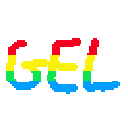
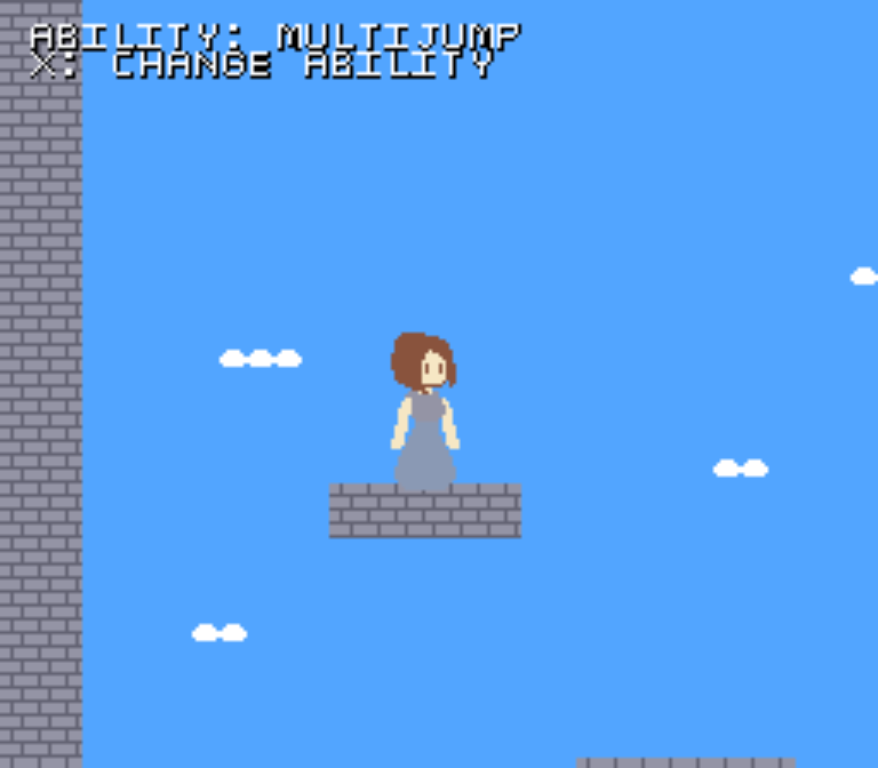

<p align="center"></p>

# GEL: a language for SNES games

GEL is a small C-like language that compiles to 65C816 assembly and builds a ready-to-run
SNES ROM (`.sfc`). It has fixed-point maths, struct tables (structure-of-arrays for fast entity
code), hardware register access, a standard library for sprites, text, scrolling and sound, and
**live hot reload**: save a source file or asset and the running emulator picks up the new ROM
without losing game state.

## Why GEL exists

In late October I wondered what it would look like to build something like Naughty Dog's GOAL
(Game Object Assembly Lisp) for the SNES. C compilers for the SNES are readable, but the code they
produce tends to be slow. GEL tries to bridge that gap: a language made for the SNES that doesn't
make you read obscure code, with inline assembly there when you want it.

GEL was built with AI assistance: I started it with Gemini and then continued with GitHub Copilot.
I'm also considering a Mega Drive version, but I don't know when that will happen.



```
struct_table Entities[16] { u16 x; u16 y; u8 type; }

fn init_game() {
    std_snes_init();
    u8 first = Entities.create();
    Entities[first].x = 100;
    while (1) {
        Entities.for_each(e) { Entities[e].x += 1; }
        std_wait_vblank();
    }
}
```

## Features

- C-like syntax: `u8/i8/u16/i16/f16`, enums, structs, `switch`, inline `asm { }`, `#include`, `#define`
- Struct tables with `create()`, `free()` and `for_each()` for entity pools
- Optimising compiler: constant folding, function inlining, peephole pass
- Asset pipeline: PNG to SNES tiles/palettes, flip-aware deduplicated metasprites, sound via SNESMOD ([docs/SOUND.md](docs/SOUND.md))
- Tiled (`.tmj`) level import: tile map, collision, object layer, streamed row by row
- Hot reload through Mesen, including level and asset edits
- Metasprite editor (`tools/metasprite-editor/`): layered, animated sprites in the browser
- VS Code extension with syntax highlighting (`snes-gel-vscode/`)

## Quick start

1. Install Python 3.10+ and `pip install lark watchdog pillow`
2. Download [Mesen 2](https://www.mesen.ca) and put it in `tools/mesen/` (or set `GEL_MESEN`)
3. Run `dev.bat` on Windows, `./dev.sh` on Linux/macOS, or `python dev.py` anywhere. It builds `game/`, launches Mesen and watches for changes

On Linux/macOS you also need Asar built as a shared library, see [docs/GETTING_STARTED.md](docs/GETTING_STARTED.md).

Full instructions: [docs/GETTING_STARTED.md](docs/GETTING_STARTED.md).
Language reference: [docs/LANGUAGE.md](docs/LANGUAGE.md). Sound setup (needs Go once): [docs/SOUND.md](docs/SOUND.md).

Release build: `python compiler/build.py game --release`

## Metasprite editor

A browser-based editor for building multi-part sprites from layered PNGs (head, hair, torso, legs,
arms...) and animating them. No install and no server: open `tools/metasprite-editor/index.html` in
Chrome or Edge and pick your project's `assets/` folder. It reads and writes `<name>.metasprite.json`,
which the build turns into tiles and animation data. Flip H / Flip V reuse tiles at no ROM cost, and
the build deduplicates the rest. Usage is in [tools/metasprite-editor/README.txt](tools/metasprite-editor/README.txt).

## Repository layout

| Path | Contents |
|------|----------|
| `compiler/` | parser, grammar, code generator, peephole optimiser, asset converters, `stdlib/` |
| `game/` | example platformer (entities, physics, Tiled level, sound) |
| `tools/` | hot-reload bridge, Mesen hook, test scripts, metasprite editor, bundled Asar and SNESMod tools |
| `snes-gel-vscode/` | VS Code language extension |
| `docs/` | documentation |

## Status

GEL is young and the language will change. See [todo.md](todo.md) for what is planned.
Windows is the main tested platform (CI runs there). The launcher and build scripts are written
to work on Linux and macOS too, but that path is untested.

## Third-party components

- [Asar](https://github.com/RPGHacker/asar) assembler (GPL-3.0 / LGPL-3.0 / WTFPL), in `tools/asar`
- [SNESMod](https://github.com/mukunda-/snesmod) sound driver and smconv (MIT), in `tools/`
- [Mesen 2](https://www.mesen.ca) emulator (GPL-3.0), downloaded separately and not redistributed

Details in [THIRD_PARTY.md](THIRD_PARTY.md).

## License

MIT, see [LICENSE](LICENSE). This covers the example game in `game/` too: the character, gem and
shell art and all sound effects were created by Pixel Brownie Software, and the example has no music.

Contributions are welcome, see [CONTRIBUTING.md](CONTRIBUTING.md) and [CHANGELOG.md](CHANGELOG.md).
